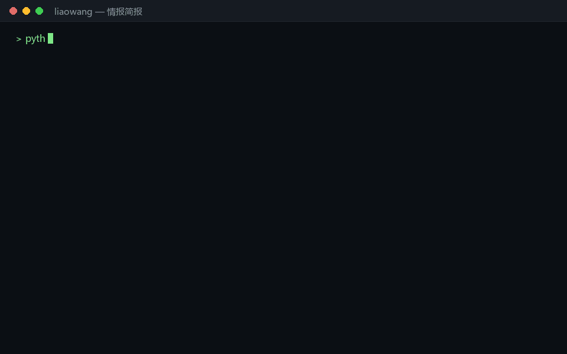
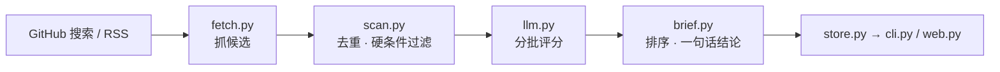

# Liaowang · Signal Over Noise

[](https://github.com/wushiyi105-jpg/liaowang/actions) []() [](./LICENSE) [](https://codecov.io/gh/wushiyi105-jpg/liaowang)

[](https://github.com/wushiyi105-jpg/liaowang/actions/workflows/test.yml)

Watch a few technical topics, fetch a batch of candidates each time, let the model decide which few are worth ten minutes, and keep the rest — along with the reason they were filtered out.

The ninth thing I built. The last one (Shouwang) was "tell me when a page changes", which solves "do not miss anything"; this one solves the opposite problem — too much comes back, so much that you never read any of it.



## It solves filtering, not fetching

Fetching is trivially easy, one `urllib` is enough. The hard part is: out of 12 candidates, which 6 are worth opening?

So in this project the model does exactly one thing — score each item and say one sentence why. Ranking, thresholds and brief format all live on the program side. That way you can tune "how many points counts as passing" yourself instead of editing a prompt and hoping the model complies.

A candidate gets: 0–100 points, a two-to-four character tag, one sentence of reasoning, and a keep/skip call.

## Why GitHub is the primary source

I originally wanted news sites and RSS. Measured on this machine, several tech sites have TLS cut outright (HN and DDG are both unreachable), and the ones that do connect change layout constantly, so parsing rules break every few days.

GitHub's search API is the stable one instead: public, returns JSON, no login needed — and for "what has recently popped up around some topic", a repository list reads far better than a press release. Star count, last push time, language: all hard information.

RSS is still there for anyone who wants to wire up their own sources. Both Atom and RSS 2.0 are supported.

## Data flow

How one piece of data moves between the modules:



## Quick start

```bash
git clone https://github.com/wushiyi105-jpg/liaowang.git
cd liaowang
cp .env.example .env        # Windows: copy .env.example .env
# open .env and fill in the key
```

Add a watch, scan once, read the brief:

```bash
python -m liaowang watch add "RAG 框架" --topic "topic:rag" --min-stars 500
python -m liaowang scan --id 1
python -m liaowang brief
```

Real output looks roughly like this (12 candidates, 6 passing):

```
=== 扫描 [1] RAG 框架 ===
抓到 12 条，新的 12 条，值得看 6，过滤 6
一句话：真正对口的是 ragflow 和 graphify，前者成熟、后者是知识图谱检索的新思路。

1. [95] infiniflow/ragflow（RAG 引擎 · 94645 star · 2026-11-24）
   直接对标主题，agent-native RAG 引擎，做选型绕不开。
   https://github.com/infiniflow/ragflow
```

Start the Web UI:

```bash
python -m liaowang serve          # http://127.0.0.1:8769
```

Add watches on the left, click "扫全部", and cards sorted by score appear on the right. Each card has a "过滤掉" button, so when the model gets it wrong you can push it down by hand.

## Command reference

| Command | What it does |
| --- | --- |
| `python -m liaowang watch add <名字> --topic <搜索词>` | Add a watch (`--source github\|rss`) |
| `python -m liaowang watch list` | List watches and last scan time |
| `python -m liaowang watch rm 1` | Delete a watch (items and runs go too) |
| `python -m liaowang scan --id 1` | Scan one |
| `python -m liaowang scan` | Scan all |
| `python -m liaowang scan --dry-run` | Fetch only, no storage, no scoring — see what comes back first |
| `python -m liaowang scan --no-model` | Store without scoring, items marked "unscored" |
| `python -m liaowang brief` | Print the brief |
| `python -m liaowang brief --min-score 80 --limit 5 --out 简报.md` | Tune the threshold, write to a file |
| `python -m liaowang show 1` | Detail of one item |
| `python -m liaowang runs` | Scan history |
| `python -m liaowang stats` | Stats |
| `python -m liaowang serve --port 8769` | Start the Web UI |

## Three principles I hold

**One: the model may fail, items may not be lost.** Fetch first, store, then score. A scoring failure marks them `unscored` and counts them separately in the brief. The thing an intelligence tool must fear is not missing scores — it is fetching something and throwing it away because of one 429, because the next scan sees the same item marked "seen" and it can never be recovered.

**Two: the score decides, the model's keep does not.** The model produces self-contradictory combinations like "keep=true but only 30 points". The program always goes by the score: under 60 is filtered, whatever it wrote.

**Three: de-duplication by key, not by title.** `gh:owner/name` normalised to lowercase, RSS by the link with punctuation stripped. The same repository found a second time never re-enters the brief.

## Layout

```
liaowang/
├── liaowang/
│   ├── fetch.py    GitHub search + Atom/RSS parsing
│   ├── scan.py     fetch → store → batch scoring → write run record
│   ├── store.py    SQLite: watches, items, scan runs
│   ├── brief.py    pick, rank, render (terminal / markdown)
│   ├── llm.py      OpenAI-compatible client (urllib only)
│   ├── cli.py      command line
│   └── web.py      http.server brief page + JSON endpoints
├── tests/          60 offline unit tests
├── scripts/        usage GIF generator (dev only, needs Pillow)
└── assets/demo.gif
```

## Tests

```bash
python -m unittest discover -s tests -v
```

60 cases, all offline. Fetching is fed fixed JSON/XML samples, no network; model calls are all mocked; covering GitHub response parsing, both Atom and RSS formats, de-duplication, batching, scan failure degradation, brief ranking, every CLI subcommand, and the six Web endpoints.

CI runs Python 3.10–3.13, see the badge above.

## Things I got wrong

**Batched takeaways contradict each other when joined.** The 12 candidates go in two batches, each returning its own takeaway. Batch one said "真正对口的是 ragflow 和 graphify", batch two said "这批没有一个是纯粹的 RAG 框架" — both true, but on one line the model looks schizophrenic. Now only the first batch's sentence is kept, because sorted by stars the first batch is the important one.

**The model keeps and underscores at the same time.** Early on I trusted its keep flag and the brief filled up with 30-point tutorial collections. Changed to "keep is advisory, the score decides", and that noise vanished.

**The GitHub search API is rate limited.** 10 requests per minute unauthenticated; one scan sends one request so normal use never hits it, but a script looping will get 403. The error carries the first 200 characters of the response body — far easier to debug than a bare status code.

**`<link>` is an attribute in Atom, not text.** Atom writes links as `<link href="..."/>`, so you read `attrib`; RSS 2.0 writes `<link>...</link>` as text. Version one only read `child.text`, so every Atom link came back empty.

**Items with no title are dropped.** Some feeds carry one or two empty titles (placeholders or ad slots); keeping them pollutes the brief.

## Switching models

Three `.env` variables, any OpenAI-style endpoint works:

```bash
# Zhipu (glm-4.6, verified working)
LLM_BASE_URL=https://open.bigmodel.cn/api/paas/v4
LLM_MODEL=glm-4.6

# DeepSeek
LLM_BASE_URL=https://api.deepseek.com
LLM_MODEL=deepseek-flash
```

Both are reasoning models and need a generous budget before they emit JSON. `scan --no-model` never touches the model at all, which is handy when you only want to see what gets fetched.

## Author

shiyi · wushiyi105@gmail.com · [@wushiyi105-jpg](https://github.com/wushiyi105-jpg)

## License

MIT
