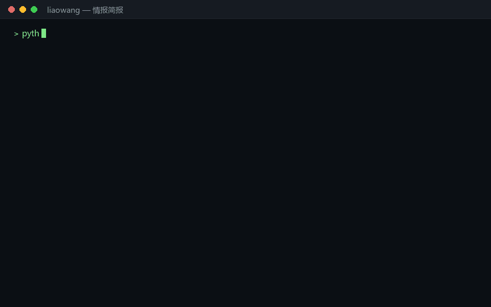
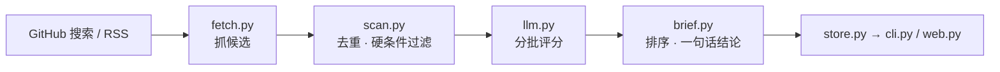

# 瞭望 · Liaowang

[](https://github.com/wushiyi105-jpg/liaowang/actions) []() [](./LICENSE) [](https://codecov.io/gh/wushiyi105-jpg/liaowang)

[](https://github.com/wushiyi105-jpg/liaowang/actions/workflows/test.yml)

盯几个技术话题，每次抓一批候选，让模型判断哪几条值得花十分钟看，其余连同过滤理由一起存着。

我做的第 9 个东西。上一个（守望）是「页面变了就告诉我」，那个解决的是「别漏」，这个解决的是反过来的问题——抓回来的东西太多，多到你根本不会看。



[打开这次本地实跑的结果图](assets/result.png) — 上面 GIF 与这张图都来自 2026-11-28 的新版界面，不是示意图。

## 它解决的是筛选，不是抓取

抓取太容易了，一个 `urllib` 就够。真正费劲的是：12 条候选里，哪 6 条值得点开？

所以这个项目里，模型只做一件事——给每条打分，说一句为什么。排序、阈值、简报格式全在程序这边。这样你能自己调「多少分才算过线」，不用去改 prompt 求模型。

一条候选会拿到：0–100 分、两到四个字的标签、一句理由、keep/skip 的判断。

## 主源为什么是 GitHub

我本来想抓新闻站和 RSS。实测下来，好几个技术站的页面在这台机器上 TLS 直接断（HN、DDG 都连不上），能连上的也经常改版，解析规则三天两头失效。

GitHub 的搜索接口反而稳：公开、返回 JSON、不用登录，而且「某个话题最近冒出来什么」这件事，仓库列表比新闻稿耐看得多——star 数、最近推送时间、语言，全是硬信息。

RSS 也留着了，给愿意自己配源的人。Atom 和 RSS 2.0 两种都认。

## 数据流

一条数据在这几个模块之间怎么走：



## 快速开始

```bash
git clone https://github.com/wushiyi105-jpg/liaowang.git
cd liaowang
cp .env.example .env        # Windows: copy .env.example .env
# 打开 .env 填 key
```

加一个监控，扫一次，看简报：

```bash
python -m liaowang watch add "RAG 框架" --topic "topic:rag" --min-stars 500
python -m liaowang scan --id 1
python -m liaowang brief
```

真跑出来大概是这样（12 条候选，6 条过线）：

```
=== 扫描 [1] RAG 框架 ===
抓到 12 条，新的 12 条，值得看 6，过滤 6
一句话：真正对口的是 ragflow 和 graphify，前者成熟、后者是知识图谱检索的新思路。

1. [95] infiniflow/ragflow（RAG 引擎 · 94645 star · 2026-11-24）
   直接对标主题，agent-native RAG 引擎，做选型绕不开。
   https://github.com/infiniflow/ragflow
```

起 Web：

```bash
python -m liaowang serve          # http://127.0.0.1:8769
```

左边加监控、点「扫全部」，右边是按分数排好的卡片。每张卡片上有个「过滤掉」，模型判错了你可以手动压下去。

Docker 运行(容器内用默认端口 8769):

```bash
docker build -t liaowang .
docker run -p 8769:8769 liaowang
```

## 🤔 为什么不用通用大模型直接问

通用模型能告诉你「最近 RAG 很火」,但瞭望补的是它做不到的三件事:

1. **先筛掉九成** —— 抓回来一批候选,模型给每条打分、写一句「为什么值得看」,其余连同过滤理由一起存着。通用对话不会替你把 12 条缩成 6 条,更不会告诉你另外 6 条为什么被扔。
2. **判断可回看** —— 每条候选的分数、理由、链接都入库,过滤掉的也在;模型判错了,Web 上按「过滤掉」能手动压回去,下周还能回头核对。
3. **数据留在本地** —— 监控项、候选、分数都在本地 SQLite;抓的是公开仓库,但你的关注清单和判断记录不必外传。
4. **结构化输出** —— 分数、理由、链接按卡片排,`--json` 能直接生成周报;通用对话给一段推荐语,没法按分数排序。

## 🎯 适用场景

- **每周看一次 RAG/Agent 新项目**:`watch add "RAG 框架" --topic topic:rag --min-stars 500`,扫一次出简报,十分钟看完值得看的六条。
- **选型前扫一遍**:要选一个 RAG 引擎,先看近期哪些项目在涨、哪些只是换皮,理由里会写清楚「对口」还是「蹭主题」。
- **给自己做技术雷达**:把扫描结果按周汇总,变成一份能交给团队看的清单,而不是随手收藏一堆链接。

## 🗺 Roadmap

- **多源接入**:除了 GitHub,接 arXiv、Hacker News 这类公开源,按同一套打分逻辑筛。
- **门槛可配**:star 数、更新时间、语言在界面上调,不用改命令行参数。
- **周报导出**:把一周的扫描结果导成 Markdown,固定版式。
- **跨周去重**:同一个项目连续三周出现只报一次,避免简报被老面孔占满。
- **已读标记**:标过的条目下次不再进「值得看」,让注意力花在新东西上。

## ❓ FAQ

**API key 从哪来?**
项目不带 key。默认接智谱(`glm-4.6`),也可以换 DeepSeek;GitHub 抓取建议再配一个 `GITHUB_TOKEN` 提高限额,见 `.env.example`。

**数据存在哪,会上传吗?**
监控项、候选与判断记录在本地 SQLite;调模型时只发候选的标题、描述与元数据。

**没有 key 能不能用?**
能抓、能存、能列候选,但不会替你筛:所有条目一视同仁地摆出来,简报失去意义。

**怎么换模型?**
改 `LLM_BASE_URL`、`LLM_MODEL`、`LLM_API_KEY`;换端点不影响抓取。

**为什么有些 star 很高的项目被过滤了?**
因为主题不对口。理由里会写「只是关键词命中」或「方向不同」;不认同就在 Web 上压回来。

## 命令参考

| 命令 | 作用 |
| --- | --- |
| `python -m liaowang watch add <名字> --topic <搜索词>` | 加监控（`--source github\|rss`） |
| `python -m liaowang watch list` | 列出监控项和上次扫描时间 |
| `python -m liaowang watch rm 1` | 删监控（连带条目和记录） |
| `python -m liaowang scan --id 1` | 扫一个 |
| `python -m liaowang scan` | 扫全部 |
| `python -m liaowang scan --dry-run` | 只抓不入库、不评分，先看抓到什么 |
| `python -m liaowang scan --no-model` | 只入库不评分，条目标「未评分」 |
| `python -m liaowang brief` | 打印简报 |
| `python -m liaowang brief --min-score 80 --limit 5 --out 简报.md` | 调阈值、写文件 |
| `python -m liaowang show 1` | 一条的详情 |
| `python -m liaowang runs` | 扫描历史 |
| `python -m liaowang stats` | 统计 |
| `python -m liaowang serve --port 8769` | 起 Web |

## 三条守住的原则

**一、模型挂了，条目不能丢。** 抓回来的东西先入库，再送去评分。评分失败就把它们标成 `unscored`，简报里单独计数。情报工具最怕的不是没评分，是抓到了却因为一次 429 把它扔掉——下次再抓到同一条已经被判「见过」，永远补不回来。

**二、分数说了算，模型的 keep 不算。** 模型会给「keep=true，但只有 30 分」这种自相矛盾的组合。程序一律按分数压：不到 60 分就是过滤，不管它写了什么。

**三、去重靠 key，不靠标题。** `gh:owner/name` 归一化成小写，RSS 用去掉符号后的链接。同一个仓库第二次被搜到，不会再进简报。

## 目录结构

```
liaowang/
├── liaowang/
│   ├── fetch.py    GitHub 搜索 + Atom/RSS 解析
│   ├── scan.py     抓 → 入库 → 分批评分 → 写记录
│   ├── store.py    SQLite：监控项、条目、扫描记录
│   ├── brief.py    挑、排、渲染（终端 / markdown）
│   ├── llm.py      OpenAI 兼容客户端（零依赖 urllib）
│   ├── cli.py      命令行
│   └── web.py      http.server 简报页 + JSON 接口
├── tests/          60 个离线单测
├── scripts/        生成示例 GIF（开发期用，需 Pillow）
└── assets/demo.gif
```

## 测试

```bash
python -m unittest discover -s tests -v
```

60 个用例，全部离线。抓取用固定的 JSON/XML 样本喂，不联网；模型调用全被 mock 掉；覆盖了 GitHub 返回解析、Atom 与 RSS 两种格式、去重、分批、扫描失败降级、简报排序、CLI 每个子命令、Web 的六个接口。

CI 跑 Python 3.10–3.13，见上方徽章。

## 几个踩过的坑

**分批的「一句话」拼在一起会自相矛盾。** 12 条候选是分两批送的，每批各给一句 takeaway。第一批说「真正对口的是 ragflow 和 graphify」，第二批说「这批没有一个是纯粹的 RAG 框架」——两句都对，拼在一行里就像模型精神分裂。现在只留第一批的说法，因为按 star 排序，第一批就是最重要的那批候选。

**模型会一边 keep 一边给低分。** 早期我信了模型的 keep，结果简报里混进一堆 30 分的教程合集。改成「keep 只是参考，分数过线才算」，这类噪音当场消失。

**GitHub 搜索接口有速率限制。** 未登录是 10 次/分钟，一次扫描只发一个请求，正常用不会撞上；但你要是写脚本循环刷，就会被 403。报错时把响应体前 200 字带出来，比只报一个状态码好排查得多。

**`<link>` 在 Atom 里是属性，不是文本。** Atom 的链接写成 `<link href="..."/>`，取值要读 `attrib`；RSS 2.0 里又是 `<link>...</link>` 的文本。第一版只读了 `child.text`，Atom 源全是空链接。

**没有标题的条目直接丢。** 有些 feed 会带一两条空标题（占位或广告位），留着会污染简报。

## 换模型

`.env` 三个变量，任何 OpenAI 风格接口都行：

```bash
# 智谱（glm-4.6，实测可用）
LLM_BASE_URL=https://open.bigmodel.cn/api/paas/v4
LLM_MODEL=glm-4.6

# DeepSeek
LLM_BASE_URL=https://api.deepseek.com
LLM_MODEL=deepseek-flash
```

两家都是推理型，预算给足才吐 JSON。`scan --no-model` 完全不联网调模型，只想先看看抓到什么的时候很有用。

## 作者

shiyi · wushiyi105@gmail.com · [@wushiyi105-jpg](https://github.com/wushiyi105-jpg)

## License

MIT
